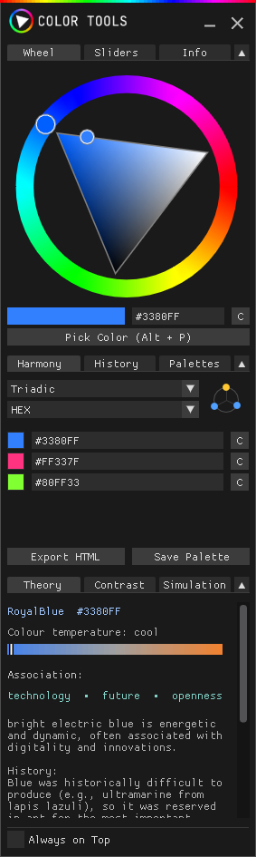
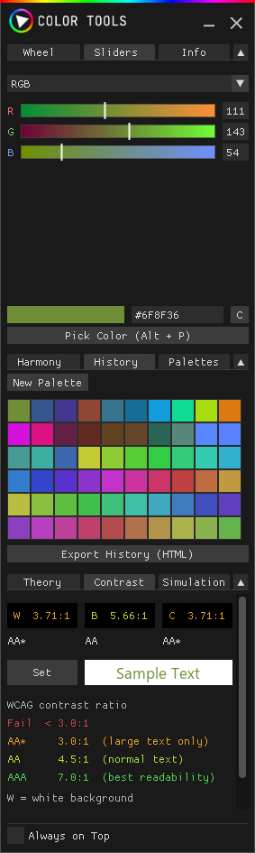
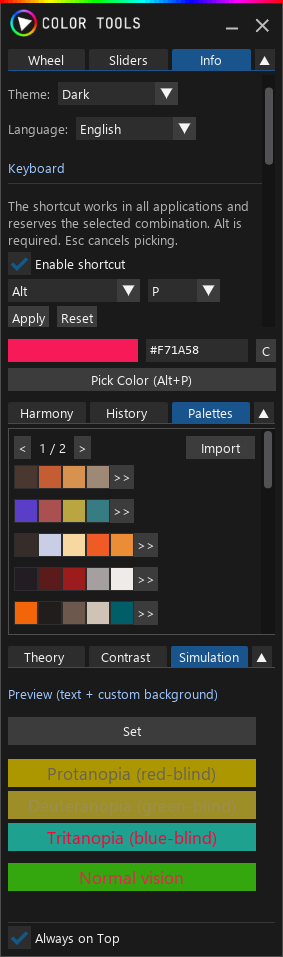

# Color Tools V1.4.1

A compact color picker and palette manager for **Windows**. Pick colors from the screen, explore color harmonies, check contrast, extract palettes from images and convert palette files between applications.

The interface starts in **English**. Finnish is available in the **Info** tab.

## Download and run

Download the standalone Windows x64 executable **ColorTools.exe** from the **V1.4.1** release in this repository's **Releases** section. Close any older running version and double-click the file. No separate Python installation is needed.

Color Tools uses the official Dear PyGui package. The GitHub version does not require a modified Python installation or a custom Dear PyGui build.

## Screenshots

Current GitHub version in the Dark theme, using example colors and palettes.

| Harmony | History | Palettes |
| --- | --- | --- |
|  |  |  |

## Features

- **Pick and edit colors:** Screen eyedropper, HEX input, copy buttons, and RGB, HSL, CMYK, LAB, OKLCH and grayscale controls.
- **Explore harmonies:** Nine modes, including complementary, analogous, triadic, tints, shades and tones. Save a harmony as a palette.
- **Manage palettes:** Create palettes from history, harmonies, images or palette files. Edit colors, drag them to reorder within a page, remove colors and undo changes. The editor displays 96 colors per page; history holds up to 60 colors.
- **Convert palette files:** Import and export ASE, ACO, GPL, Procreate `.swatches` and Affinity `.afpalette` files.
- **Extract colors from images:** Open PNG, JPEG, BMP, GIF, WebP or TIFF files. Choose a target of 2–30 colors and preview the palette before saving it.
- **Check contrast:** Compare colors against white, black or a custom background, with WCAG contrast ratios, AA/AAA indicators and a text preview.
- **Simulate color vision differences:** Preview protanopia, deuteranopia and tritanopia.
- **Explore color theory:** Read about color associations, historical context and possible uses in interfaces. The warm/cool indicator describes visual character, not a measured temperature in kelvin. Associations are contextual guidance rather than universal rules.
- **Export HTML references:** Save palettes, harmonies or history with color values, contrast information and color theory notes.
- **Personalize the interface:** Seven themes, collapsible sections, an optional always-on-top mode and automatic saving of palettes and preferences.

## Picking a color

Click **Pick Color**, or press **Alt+P**, then click the color you want on the screen. Press **Esc** to cancel.

Change the shortcut in **Info → Keyboard**. Choose a supported combination and press **Apply**, or use **Reset** to restore Alt+P. Shortcuts require Alt and can also include Ctrl or Shift, together with a letter, number or F1–F11.

Disabling **Enable shortcut** disables only the keyboard shortcut. The button remains usable and reads **Pick Color**, without a shortcut suffix. While enabled, the shortcut is system-wide and reserves its combination. If registration fails, the application reports it and restores the previous setting when possible.

## Palettes and file formats

Drop a supported file onto the window, or choose **Import** in the **Palettes** tab. Confirm the preview, open the palette editor and choose **Export** to save in another format.

| Starting point | Example conversion |
| --- | --- |
| Procreate `.swatches` | Affinity `.afpalette` |
| Affinity `.afpalette` | Adobe `.ase` or Procreate `.swatches` |
| Adobe `.aco` | GIMP `.gpl` |
| Photo or illustration | Extract colors and export a palette |

Palette imports retain up to **1,000 colors**. Imported colors become opaque RGB; original color names, color profiles and other metadata are not preserved. Not all variants of these formats are supported.

ACO imports support RGB, HSB and CMYK. Unsupported color spaces, including Lab and Gray, are skipped and reported in the preview. ACO exports are limited to 65,535 colors.

Undo retains up to 30 changes, subject to a shared memory limit; large palettes may have fewer undo steps. Undo history is not saved between sessions.

HTML exports open in the default browser after saving. If the browser cannot be opened, the saved file can still be opened manually.

## Settings and fonts

Settings and logs are stored in `%APPDATA%\Color Tools`. Palettes, history, language and preferences are remembered. The currently selected color is not restored after restarting.

Palette edits are saved after a short delay, and normal shutdown saves immediately. If settings contain damaged data, the application attempts to preserve the original in a backup before recovering readable settings. Save or recovery failures are reported in the interface.

UI text uses Windows Segoe UI. Color values and slider numbers use Consolas, with a UI-font fallback if unavailable. The eyedropper overlay also uses Consolas with antialiased text.

## Run from source

Tested with **Python 3.14 x64 on Windows**. From the repository folder in PowerShell:

```powershell
python -m venv .venv
& .\.venv\Scripts\python.exe -m pip install -r requirements.txt
& .\.venv\Scripts\python.exe -B run_app.py
```

Alternatively, launch with `python -m color_tools` from the activated environment. Dependencies are pinned to **Dear PyGui 2.2** and **Pillow 12.3.0**. Pillow is required for image imports.

## Build the EXE

```powershell
& .\.venv\Scripts\python.exe -m pip install -r requirements-build.txt
& .\.venv\Scripts\python.exe -B -m PyInstaller --noconfirm ColorTools.spec
```

The result is **`dist/ColorTools.exe`**, a standalone executable with UPX disabled. Build it from this V1.4.1 source folder and upload it as an asset of the **V1.4.1** GitHub Release, using **V1.4.1** as the release tag. The application's Info tab displays **Color Tools v1.4.1**. Keep generated binaries, build directories and local Python environments out of the source repository.

## Tests

Run regression tests on Windows:

```powershell
& .\.venv\Scripts\python.exe -B -m unittest discover -s tests -v
```

Tests use isolated settings in `.test-runtime`, leaving your normal settings unchanged. The latest verification passed **90 regression tests**.

Optional render checks open a test window and check tab widths and value-field alignment:

```powershell
& .\.venv\Scripts\python.exe -B tests/verify_tabs.py 1.0
& .\.venv\Scripts\python.exe -B tests/verify_value_fonts.py 1.0
```

Use `1.5` instead of `1.0` to check the larger layout scale. Automated checks do not replace manual testing of screen picking, global shortcuts, file dialogs or moving the window between monitors with different DPI settings.

## License

[MIT](LICENSE) — Copyright (c) 2026 sort0m.
